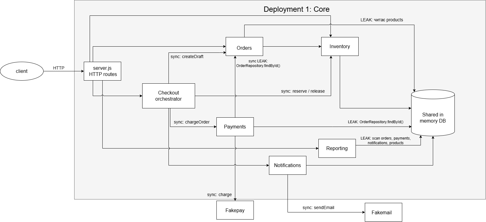
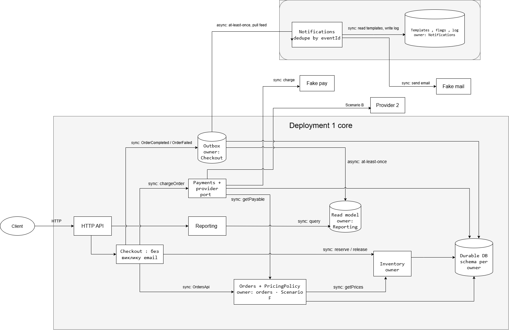

# OrderFlow: Architecture Analysis

## 1. Current architecture

## 2. Proposed architecture

## 3. Decision summary

**Problem.** Критичний шлях Checkout синхронно залежить від повільних зовнішніх систем (payment provider, email), а модулі зв'язані через спільні дані без контрактів і власників. Тому проста зміна зачіпає кілька модулів і потребує повного deployment та regression.

**Evidence.**

| Метрика | 6 міс. тому | Зараз |
|---|---|---|
| Modules Changed per Feature | 1,7 | 4,3 |
| Change Lead Time | 2 дні | 6 днів |
| Rollback Rate | 2% | 9% |
| Production Incidents | 1 на місяць | 5 на місяць |

- 48% feature PR торкаються Orders і Payments одночасно; 37% змін notification templates потребували повного regression checkout. Два останні інциденти почалися під час latency spikes payment provider. Документ прямо зазначає, що кореляція не доводить архітектурної причини.
- **Код, критичний шлях:** `CheckoutService` робить `await notificationService.sendOrderConfirmation()` усередині `try`, а `PaymentService` викликає `provider.charge` без timeout.
- **Код, помилка, яку я відтворив:** якщо email падає після успішної оплати (за конфігом ~2% викликів), `catch` звільняє stock і ставить `FAILED`, хоча платіж уже `CAPTURED`. Запуск із mock-провайдерами дав order = `FAILED/PAID`, payment = `CAPTURED`, stock повернуто.
- **Код, порушення boundaries:** `PaymentService` читає `OrderRepository.findById`; `OrderService` читає `database.products` (дані Inventory); `ReportingService` сканує `orders`, `payments`, `notifications` і `products`.
- **Код, template:** шаблон листа захардкоджено в `NotificationService` і деплоїться разом із усім застосунком.
- **Код, сховище:** єдина in-memory database, яка живе в пам'яті process.
- **Тести:** `npm test` дає 5 passed, 0 failed. Вони не покривають збій email після оплати.

**Decision.** Еволюція всередині modular monolith плюс одне виділення, без переходу всіх модулів на services:

1. Contracts та data ownership: `OrdersApi.getPayable`, `InventoryApi.getPrices/reserve/release`, provider port у Payments (Scenario B), durable DB зі schema per owner. Окремо для Scenario D: умовне оновлення stock і unique `operationKey`.
2. Checkout без виклику email (Scenario E): подія `OrderCompleted/OrderFailed` записується в Outbox (власник Checkout) разом зі станом order; Notifications забирає її asynchronously (at-least-once, dedupe по `eventId`). Для payment додається timeout.
3. Notifications стає окремим deployment (Scenario A) зі своїми templates, flags і log. Це перше виділення: найчастіші зміни (2-3 на тиждень), низький вплив на revenue, можливість швидко вимикати експерименти.
4. Reporting читає власний read model, який наповнюється з Outbox (Scenario C). Окремий store чи deployment для нього — лише якщо навантаження це виправдає.
5. Orders володіє `PricingPolicy` (Scenario F), і Payments списує суму з `getPayable`.
6. Orders, Payments і Inventory лишаються разом: вони змінюються разом (48% PR), а розділення додало б network partial failures саме на шляху оплати.

Повне перетворення на services з `architecture-proposal.md` відхилено. Команда має 8 engineers і 2 QA, окремої platform team немає, а відкриті питання proposal (Reporting store, consistency, end-to-end reliability) не закриті.

**Trade-offs.**

- **Пріоритети:** 1) availability і resilience Checkout; 2) modifiability і deployability; 3) consistency Inventory; 4) scalability Reporting.
- **Чим поступаємося:** лист і звіти стають eventually consistent (Scenario C допускає затримку в кілька хвилин); з'являється Outbox, durable DB і другий deployment; Orders, Payments і Inventory не деплояться незалежно; зростає infrastructure cost.
- **Нові failure modes:** дублікати подій, lag консьюмера, збій міграції зі спільного in-memory DB на schema per owner.

**How we will measure success.**

- Збій Notifications або FakeMail не змінює статус order і не повертає stock (0 випадків `FAILED` при `CAPTURED`).
- Зміна template не торкається Orders, Payments і Inventory, і деплоїться окремо.
- Повторний `reserve` або `release` не змінює stock двічі, перевірка під concurrent-навантаженням.
- Reporting-запит не читає таблиці Orders, Payments і Inventory.
- Метрики з розділу 6.

## 4. Principles

| Principle | Де порушено зараз | Як змінює proposal |
|---|---|---|
| Information Hiding | `PaymentService` бере `OrderRepository.findById`; `ReportingService` сканує колекції `orders`, `payments`, `notifications`, `products` напряму | Репозиторії та колекції приватні для власника; Payments викликає `OrdersApi.getPayable`; Reporting читає лише власний read model |
| Explicit Contracts | `OrderService` рахує total через `calculateOrderTotal(items, this.database.products)`, тобто залежить від внутрішньої структури даних Inventory; `FakePaymentProvider` не має оформленого port, а контракт Scenario B не визначений | `InventoryApi.getPrices`, `OrdersApi`, provider port у Payments, схема події з `eventId` |
| Dependency Direction | `CheckoutService` чекає на `sendOrderConfirmation` (у коді позначено як deliberate critical-path dependency); Payments залежить від Orders repository | Checkout не залежить від Notifications; Notifications залежить від подій Outbox, а не навпаки |
| Design for Change | Шаблон листа захардкоджено в `NotificationService`; 37% змін templates потребували regression Checkout | Templates і flags у власному сховищі Notifications у Deployment 2 |

## 5. Risk analysis

**Assumptions:** Probability — ймовірність щонайменше одного прояву за квартал (0-1); Business Impact — умовні одиниці 0-100 (100 — найгірший збиток для бізнесу); усі значення — assumptions, а не виміряні дані; Expected Risk Cost = Probability × Business Impact — умовна оцінка, не фактична вартість.

| Risk | Probability | Business Impact | Expected Risk Cost | Mitigation |
|---|---|---|---|---|
| Поточний: після оплати збій email переводить order у `FAILED`, повертає stock, платіж лишається `CAPTURED` | 0,9 | 60 | 54 | Прибрати email із Checkout (Outbox); заборонити перехід `COMPLETED → FAILED`; тест на цей сценарій |
| Поточний: latency або outage payment provider блокує Checkout (немає timeout) | 0,6 | 80 | 48 | Timeout і circuit breaker у provider port; fail fast; алерт на p95 викликів provider |
| Proposal: порушення idempotency Inventory під час міграції на durable DB та ownership (Scenario D) | 0,2 | 90 | 18 | Unique constraint на `operationKey`; умовне оновлення `stock >= qty`; concurrency-тест до cutover |
| Proposal: Outbox: дублікати подій, lag, розходження read model | 0,4 | 25 | 10 | Запис події в одній транзакції зі станом order; dedupe по `eventId`; алерт на lag; можливість перебудувати read model |
| Proposal: операційне навантаження другого deployment на команду без platform team | 0,35 | 40 | 14 | Лише один додатковий deployment; Outbox буферизує події, поки Notifications недоступний; runbook; flag для вимкнення експериментів |

## 6. Metrics та Fitness Function

Targets нижче є запропонованими цілями, а не наявними фактами. Причинність зміни метрик через архітектуру не доведена.

| Metric | Зараз → Target | Чому важлива |
|---|---|---|
| Modules Changed per Feature | 4,3 → <2,5 (приклад цілі з README) | Прямо вимірює cost of change від coupling |
| Change Lead Time | 6 днів → ≤3 дні | Показує швидкість реакції на зміни (6 місяців тому було 2 дні) |
| Rollback Rate | 9% → ≤4% | Показує blast radius одного deployment |
| Зміни templates із повним regression Checkout | 37% → 0% | Перевіряє ізоляцію Notifications (Scenario A) |
| Cross-owner залежності між модулями (Orders→products, Payments→Orders repo, Reporting→4 колекції) | 6 (підраховано з коду) → 0 | Показує, що ownership реально працює |
| p95 latency Checkout | Not measured → baseline, далі зменшення на email-крок | Checkout напряму впливає на revenue; baseline треба виміряти |

**Fitness Function** (proposed, ще не реалізована)

- **Name:** Module Boundary Rule.
- **Property:** Dependency Direction та Information Hiding: модуль звертається до чужих даних лише через public API власника.
- **Rule:** repository-класи та колекції `database.<collection>` належать одному модулю (`products`, `inventoryOperations` — inventory; `orders` — orders; `payments` — payments; `notifications` — notifications). Звертатися до них і імпортувати `*Repository` чужого модуля можна лише в межах власного `src/<module>/`. Крос-модульні імпорти допустимі тільки через `src/<module>/index.js`. Виняток — composition root (`app.js`). Reporting не звертається до жодної з цих колекцій, а лише до власного read model.
- **Implementation:** `tests/architecture.test.js` на вбудованому `node:test`, який запускається наявним `npm test` без нових dependencies (у проєкті їх немає). Тест читає файли `src/**/*.js`, розбирає `import` і шукає звернення `database.<collection>` та імена `*Repository` за мапою власників; у CI блокує merge.
- **Pass/Fail:** Pass — 0 порушень. Fail — будь-яке порушення (імпорт чужого внутрішнього файла, доступ до колекції чужого модуля, використання чужого repository). На поточному коді правило не пройшло б: 6 порушень, а саме Orders→products, Payments→`OrderRepository`, Reporting→`orders`, `payments`, `notifications`, `products`.
